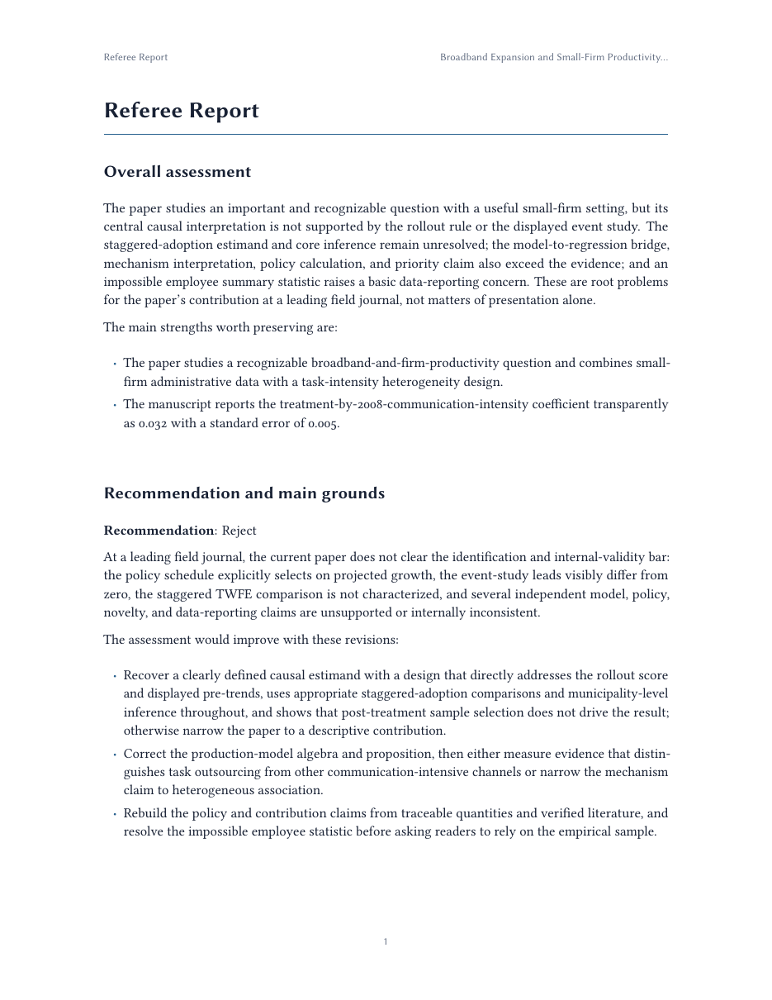
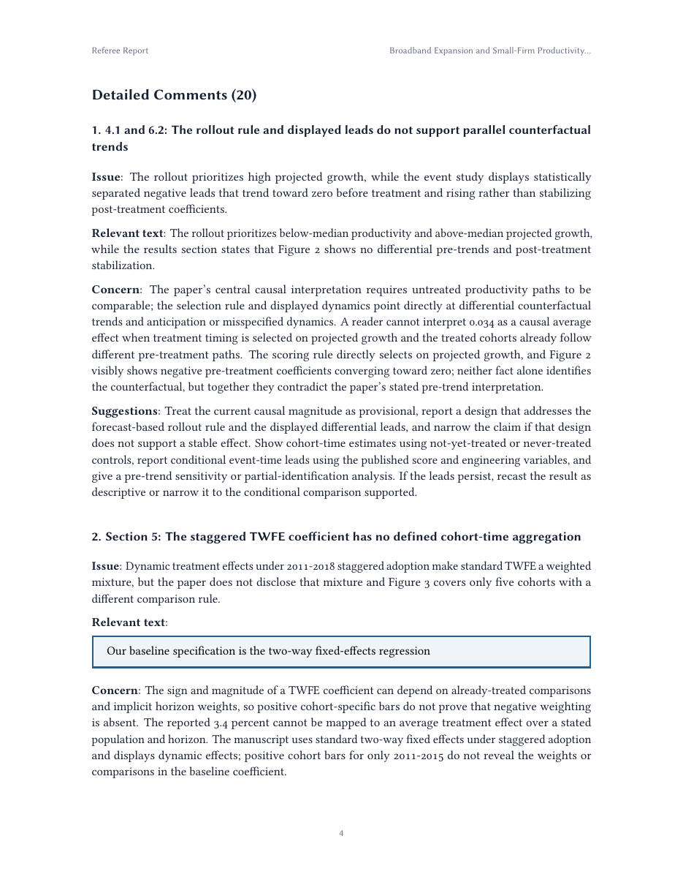
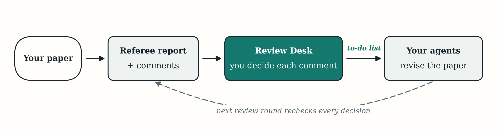
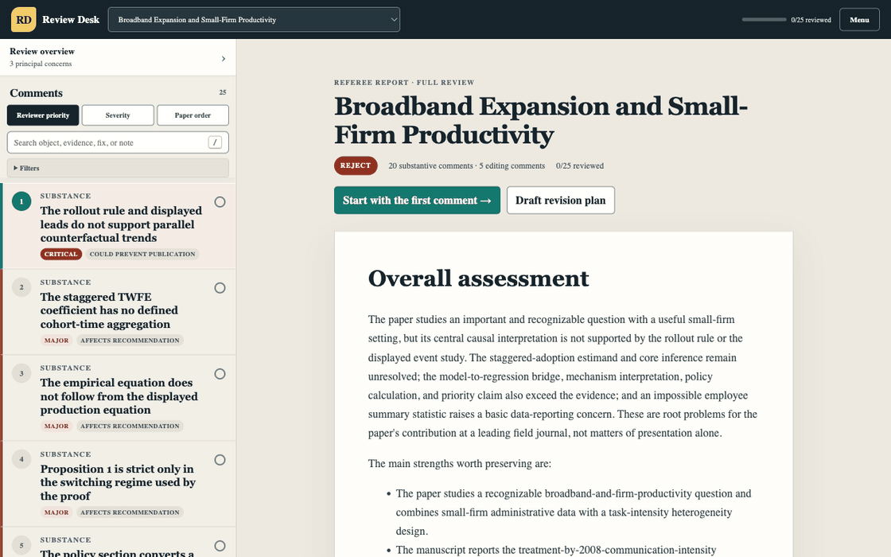

# Econ Paper Review Skill

**Get a tough, fair referee report on your economics paper — before a real referee sees it.**

[](LICENSE)
[](#install)
[](#install)
[](./README.md)
[](./README.zh-CN.md)

*Source-available and free for academic, personal, and other noncommercial research use — see [License](#license).*

| The referee report | The detailed comments |
|---|---|
|  |  |

*Two pages from the bundled [25-comment sample review (PDF)](docs/sample-review/paper-review.pdf), produced cold in full mode for a leading field journal on a [demonstration manuscript](docs/sample-review/demo-paper.pdf) written with intentional errors. The sample was generated before v0.3.0, which drops most restated repairs from Suggestions and gives revision-plan items the same numbers as the report.*

`econ-review` is an Agent Skill for Claude Code and Codex. It reads your paper the way a careful journal referee would: first it works out what you are claiming and how your evidence supports it, then it checks everything it can verify — identification, tables, proofs, numbers, references, writing — and gives you a referee report plus a step-by-step plan for fixing what it found. It never rewrites your paper. That part stays yours.

*Built for economics. Also works well for finance, accounting, political economy, and other social science papers that rest on data, causal inference, or formal models.*

## What you get

A finished review lands in a clean `review/` folder next to your paper. If that folder is synced (an Overleaf project in Dropbox, iCloud Drive, OneDrive) or tracked by git, the agent asks first, because the review is confidential:

- **`paper-review.pdf`** — the primary report: a professionally typeset, bookmarked PDF with the referee report, every detailed comment, editing comments, and the revision plan.
- **`reports/`** — the same reports as Markdown. The revision plan is a prioritized to-do list written to be handed straight to your agents.
- **`README.md`** — a one-page summary that tells you what to read first.
- **`supporting/`** — working files used by the Review Desk and later review rounds; most authors never open them.

Every comment quotes the relevant manuscript text — or, when the issue comes from a checked comparison or calculation, states that basis directly — then explains why it matters and what to do:

> ### 8. Section 4.2: Table 1 reports an employee mean above the employee maximum
>
> **Issue**: The employee mean is 23.40 even though the employee maximum is 19.00 in the same table and sample.
>
> **Relevant text**: Table 1 labels the employee mean as 23.40 and the employee maximum as 19.00.
>
> **Concern**: An impossible mean-max relationship indicates a transcription, column-alignment, sample, or data-generation error that could extend beyond this cell. The sample description and basic data audit are not trustworthy until an impossible summary statistic is reconciled. The rendered table unambiguously displays a mean of 23.40 and a maximum of 19.00 for employees; the review cannot determine which number or column is wrong without the underlying data.
>
> **Suggestions**: Reproduce Table 1 from the analysis sample, correct the row or column, and audit all displayed summary statistics against the generating output. Create the table directly from the final analysis sample, compare every cell with the generating output, and update the prose mean and sample description from that same output.

*(Comment 8 of the bundled sample review, verbatim. Full reviews keep every issue that survives verification — up to 100 substantive comments and 30 editing comments.)*

**[Read the full sample review (PDF)](docs/sample-review/paper-review.pdf)** — all 25 comments, not just the excerpt above.

## Install

Works on macOS, Windows, and Linux. The recommended installation is a
standalone skill, which keeps the short `/econ-review` command in Claude Code
and `$econ-review` mention in Codex. Paste this into either client:

```text
Install or update Econ Review as a standalone skill for this client. Read and
follow the complete instructions at
https://github.com/hanlulong/econ-paper-review-skill/blob/main/INSTALL.md.
Handle installation, same-client migration, and verification yourself; keep
exactly one active copy for this client, do not change the other client, and do
not ask me to run commands. Report completion or the one genuine blocker.
```

Use the same prompt later to update Econ Review; the workflow is idempotent and
reuses a compatible runtime. Updating also repairs a standalone copy installed
before v0.3.0, which carried plugin manifests and therefore appeared as
`econ-review@skills-dir` in Claude Code and `econ-review:econ-review` in Codex.
Installing needs an existing Python 3.10+ with working `venv` and pip
bootstrapping support. On macOS the built-in `python3` is 3.9; install Python
3.13 or 3.14 from [python.org](https://www.python.org/downloads/macos/) (3.15
is not tested yet), or run `brew install python@3.12` or
`uv python install 3.12`, before pasting the prompt. Full manuscript-PDF ingestion also needs
[Poppler](https://poppler.freedesktop.org/) on `PATH`; TeX, Pandoc, Node.js, and
administrator access are not required.

<details>
<summary>Direct standalone installation from a checkout</summary>

```bash
git clone https://github.com/hanlulong/econ-paper-review-skill.git
cd econ-paper-review-skill
python3 scripts/install_econ_review.py --dry-run --global --all --with-review-desk
python3 scripts/install_econ_review.py --global --all --with-review-desk
```

Use `--claude` or `--codex` instead of `--all` when installing for only one
client. On native Windows, run
`python scripts\install_econ_review.py --global --all --with-review-desk` in
PowerShell. Use the machine's working Python 3.10+
command; the optional `py` launcher is not required. If a compatible, working
LuaLaTeX or Tectonic renderer is available, the report uses it; otherwise it
uses the maintained built-in PDF renderer. Review Desk is prebuilt and needs no
Node.js or npm. See [INSTALL.md](INSTALL.md) for migration, updates, source
installation, and project-local setup.

</details>

<details>
<summary>Optional native plugin installation</summary>

Native plugins remain available for users who prefer marketplace-managed
updates. Do not install both the standalone skill and native plugin in the same
client. Plugin skills are namespaced: use `/econ-review:econ-review` in Claude
Code or `$econ-review:econ-review` in Codex.

Claude Code:

```text
/plugin marketplace add OpenEconAI/plugins
/plugin install econ-review@openeconai
```

Codex:

```bash
codex plugin marketplace add OpenEconAI/plugins
codex plugin add econ-review@openeconai
```

Plugin clients do not provide a portable trusted post-install action. After a
direct plugin install, send the agent this one message:

```text
Run econ-review-setup now and finish its user-level setup with Review Desk.
```

The plugin already contains the complete review workflow and setup tool. The
setup message may download only the declared core Python packages into Econ
Review's private environment; it never uploads a manuscript or silently
installs system software. After each plugin update, send the same message
again so Review Desk is updated too. See [the installation guide](INSTALL.md)
for migration, removal, and troubleshooting.

Never paste a token or package-index credential into chat or a shell command.

</details>

## Use it

The skill can activate automatically from an ordinary paper-review request.
Put your manuscript in your working directory — the PDF, plus the LaTeX or
Markdown source if you have it — and ask:

```text
Review this paper in full mode for a leading field journal.
Review this paper in quick mode and identify the three largest submission risks.
Reconstruct the theory and empirical design before giving detailed comments.
```

To invoke the standalone skill explicitly, use `/econ-review` in Claude Code
or `$econ-review` in Codex.

`quick` gives you the biggest risks fast. `full` goes through every section, table, figure, equation, footnote, and appendix. When it finishes, open `review/paper-review.pdf`; `review/README.md` gives the file map, how to open the review in Review Desk, and the next-round steps.

> [!IMPORTANT]
> **A full review often takes 30 minutes or longer**, and a long or technical paper with live literature verification may take substantially longer. Let it run to the end — the verification passes that keep the comments trustworthy happen late in the run. Use `quick` mode when you need a faster first pass over the largest risks.

Then hand the to-do list to your agent — the revision plan is written for exactly that:

```text
Implement the P0 items in review/reports/revision-plan.md. Follow each instruction,
never invent results or citations, and report what changed where.
```

You decide, your agent revises, and the next review round checks every change.

## Why you can trust the comments

AI peer review usually fails in one of two ways: it makes things up, or it hands you a generic checklist. This skill was built specifically against both:

- **It reads your paper before it judges it.** It reconstructs the argument first and, where the supplied inputs permit, re-derives key equations and traces reported results. Comments come from understanding the paper, not from pattern-matching on keywords.
- **It checks comments against the source.** Quotations, equations, tables, and figures are checked against the supplied source or rendered PDF pages; reviewer-derived comparisons and calculations are labeled in plain language instead of presented as quotations.
- **It argues with itself before it argues with you.** Before a major comment reaches the report, the skill searches your paper and appendix for the strongest reply you could make. If your reply would win, the comment is deleted.
- **It checks your contribution against live literature.** Each novelty and citation claim becomes a targeted search; candidate papers are screened, authors and versions confirmed, and available full texts read before the review calls a citation missing or a contribution overstated. When the evidence is not decisive, it says so.

Every review also passes a set of automatic consistency checks before it is shown to you as finished.

## What it covers

Any kind of economics paper: empirical, experimental, descriptive, prediction and machine learning, structural, theoretical, macro, and mixed. The review adapts to how your paper actually works — its identification, inference, logic and proofs, magnitudes, framing of the contribution, terminology, exhibits, references, and reproducibility.

**Not just economics.** The checks target how a paper's evidence supports its claims — research design, causal inference, estimation and inference, formal models and proofs, tables and figures, reproducibility — so papers in finance, accounting, management, political science, public policy, and other empirical social sciences get the same depth of review. Journal norms and literature search are economics-first for now; anything field-specific the review can't assess is said plainly rather than guessed.

## What it does not do

It won't write your paper, estimate your acceptance odds, or invent citations. When it couldn't check something — a dataset it didn't have, a figure it couldn't read — it says so instead of pretending. And it doesn't claim to beat human referees: treat it as a tough extra reader before submission, not a replacement for peer review.

Refereeing a submission for a journal? Check the journal's reviewer AI policy first. Many journals bar uploading a submission to AI tools or require you to disclose AI use, and the skill asks before it reviews a manuscript you did not write.

## How it compares to Refine.ink and other AI review services

[Refine](https://www.refine.ink/) deserves credit for showing economists that AI pre-submission review is worth taking seriously. The two tools do the same job with different trade-offs, and some authors will want both:

| | econ-review (this skill) | Refine.ink |
|---|---|---|
| **Cost** | Free for noncommercial use; source-available — you bring your own Claude Code or Codex subscription | First document free, then $49.99 per review ($30–40 each in packs, as of November 2026) |
| **Iteration** | Built for rounds: review → decide each comment in Review Desk → your agents revise → the next round rechecks every decision | Each review is a separate purchase |
| **Deliverable** | Referee report + verified detailed comments + editing comments + a revision plan written for your agents | Referee-style substantive comments |
| **Where your paper goes** | Runs inside your own agent; nothing is uploaded to us, and your existing AI-provider terms apply | Uploaded to their service (SOC 2 / ISO 27001 certified, no training on papers) |
| **Openness** | Every prompt, check, and rubric is in this repo — read it, fork it, tune it to your field | Closed pipeline |
| **Setup** | Requires Claude Code or Codex | None — upload a PDF |

Other hosted reviewers — referee3.app, Stanford's PaperReview.ai — sit on Refine's side of the same trade-offs.

If a command line is not an option, a hosted service is the practical choice today — or wait for the [hosted version](#roadmap) of this skill. This page makes no comparative quality claims: the bundled benchmark cases check that the right audits run, not how many real errors a review finds.

## The Review Desk (optional)

A local web viewer that turns a long review into a decided, trackable revision plan:



1. **Read the report first.** The Desk opens on the referee report, and every concern links straight to its detailed comment.
2. **Decide each comment.** Read it beside its manuscript evidence, add your instruction or disagreement, set your own P0/P1/P2 priority, and make one clear decision — keep it **Open**, mark it **Ready for review** after a change or reasoned response, or **Set aside**.
3. **Hand off the plan.** The Desk assembles your decisions into a prioritized to-do list and a structured response template for your agents.
4. **Close the loop.** The next review round checks every carried decision and runs a fresh full-paper sweep for new problems.



Everything stays on your machine — no uploads or accounts.

The recommended installer includes a verified, prebuilt copy with `--with-review-desk`; it prints one stable launch command and opens `http://127.0.0.1:48127/`. Launching it again reuses the verified local server; `--port PORT` selects another loopback port. Your decisions are saved in the browser for that address, so export them before switching browsers or ports. To try the Desk before your first review finishes, choose **Open review folder** and select `docs/sample-review/review` from a checkout of this repository: a small synthetic review package. Node.js is required only to modify or rebuild the viewer; see [review-viewer/README.md](review-viewer/README.md).

## Roadmap

- A blind benchmark, with errors embedded rather than described and a sealed answer key, before any precision, recall, or comparative claims
- More design-specific checks (RCT, shift-share, synthetic control, structural, macro-VAR)
- Round-by-round usability improvements for author, implementation-agent, and re-review handoffs
- **A hosted version** — upload a PDF and receive the full review without a command line. Coming later.

## Related projects

- [econ-writing-skill](https://github.com/hanlulong/econ-writing-skill) — the writing-side sibling: this skill judges the paper, that one helps you write it
- [econ-slides-skill](https://github.com/hanlulong/econ-slides-skill) — after the revision: turn the paper into a professional Beamer talk with a speaker script
- [stata-mcp](https://github.com/hanlulong/stata-mcp) — run Stata from AI agents
- [awesome-ai-for-economists](https://github.com/hanlulong/awesome-ai-for-economists) — the broader toolbox

## Development and advanced installation

PDF backends, the output contract, the validation suite, and the release process are documented in [docs/DEVELOPMENT.md](docs/DEVELOPMENT.md).

## License

Econ Paper Review is source-available under the [PolyForm Noncommercial License 1.0.0](LICENSE). It is free to use, modify, and share for personal research, study, and other noncommercial purposes under that license. PolyForm expressly permits use by charitable organizations, educational institutions, public research organizations, public safety or health organizations, environmental protection organizations, and government institutions, regardless of their funding source or related funding obligations.

Use outside those permissions, including commercial use by other organizations, requires separate terms. For commercial licensing, contact [hanlulong@gmail.com](mailto:hanlulong@gmail.com). The copyright holder may also offer the software under other terms and reserves the right to operate paid hosted services, including a future premium service.

Unless a file or third-party notice says otherwise, the public license covers the repository's first-party source code, documentation, prompts, schemas, tests, designs, and bundled first-party materials. Third-party components remain under their respective licenses; see [`THIRD_PARTY_NOTICES.md`](THIRD_PARTY_NOTICES.md).

Contributions are welcome, and contributors retain ownership of their work. Before proposing a code or documentation change, read [`CONTRIBUTING.md`](CONTRIBUTING.md).

---

If this catches something a referee would have caught, star the repo so other economists find it — and if it gets something wrong, open an issue. Bad comments are bugs here, not opinions.
